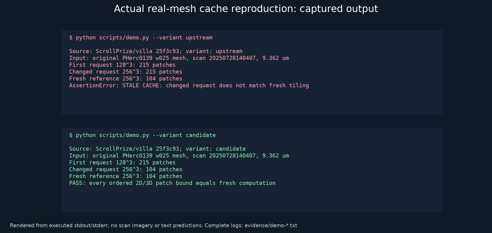

# Reliable TIFXYZ patch-cache reuse

A focused, AI-assisted ScrollPrize Progress Prize contribution: fix stale patch
layouts when a researcher changes model context size or tiling settings on a real
scroll surface. This is an upstream patch and evidence package, prepared locally
for review. Nothing has been published or submitted.

On the original PHerc0139 w025 mesh, the upstream method returns **215 patches**
after changing from 128³ to 256³ voxels. A fresh 256³ calculation returns **104**.
The patch returns exactly those 104 ordered bounds. Changing overlap from 0 to
0.5 through a disk cache returns **62 instead of 261** upstream; the patch
returns exactly the fresh 261-bound layout.

Across two complete public meshes, four scenarios and three repetitions, patched
results match fresh calculation in **24/24 runs**; upstream matches in **6/24**
(the already-correct disk target-size controls). First-request and fresh results
remain identical across versions. **75 tests pass**, including 20 new focused
regressions and 55 relevant upstream tests. No model-quality, ink-recovery,
speedup, community-adoption or award claim is made.



## Reproduce

Tested on Windows x64, Python 3.14.6, CPU only. The upstream subproject requires
Python `>=3.14,<3.15`. This is a focused source harness for the real tifxyz
subpackage, not a full monorepo/GPU install. `scripts/source_loader.py` supplies
only the parent package namespace to avoid unrelated Volume/ML initialization;
the actual reader, tiler, numerical dependencies and shared canvas code run
unchanged from pinned official sources.

From this directory, in PowerShell:

```powershell
python -m venv .venv
.\.venv\Scripts\python.exe -m pip install -r requirements-lock.txt
.\.venv\Scripts\python.exe scripts\verify_sources.py
.\.venv\Scripts\python.exe scripts\verify_patch.py
.\.venv\Scripts\python.exe scripts\fetch_inputs.py
.\.venv\Scripts\python.exe -m pytest -q tests upstream\vesuvius\tests\tifxyz candidate\vesuvius\src\vesuvius\tifxyz\test_reader_bbox.py candidate\vesuvius\src\vesuvius\tifxyz\test_labels.py
.\.venv\Scripts\python.exe scripts\evaluate.py --repetitions 3
.\.venv\Scripts\python.exe scripts\create_evidence.py
```

On Linux/macOS use `.venv/bin/python` and forward slashes. Those platforms were
not executed here; no Windows-specific numerical code was added. Exact installed
versions are locked; lock versions were tested on Windows/Python 3.14 only.
The two anonymous S3 inputs total **1,631,776 bytes**, tracked by URL and SHA-256
in `docs/*-provenance.json`. If the upstream data change, fetching stops on a
hash mismatch. Original meshes are not distributed in this package. They remain
private local copies, separate from the MIT software license. See
[attribution](docs/attribution.md) for data-use/publication conditions.

For the baseline regression check (failure is expected):

```powershell
$env:TIFXYZ_SOURCE_VARIANT = 'upstream'
.\.venv\Scripts\python.exe -m pytest -q tests --tb=short
Remove-Item Env:\TIFXYZ_SOURCE_VARIANT
```

This yields 14 failed and 6 passed cache-contract tests. The minimal actual
real-data demonstration is `python scripts/demo.py --variant upstream`
(expected exit 1), then `--variant candidate` (expected exit 0).

## Use the fix in a full upstream checkout

`upstream-fix.patch` changes only
`vesuvius/src/vesuvius/tifxyz/types.py` and adds
`vesuvius/tests/tifxyz/test_patch_cache.py`. It applies cleanly to official villa
revision `25f3c93c65b492be3b90e402213a1ba6b5fd624c`; that file still matched main
at the final check. In a separate upstream checkout at that revision:

```text
git apply --check /absolute/path/to/upstream-fix.patch
git apply /absolute/path/to/upstream-fix.patch
```

Follow the upstream `vesuvius/README.md`, `pyproject.toml`, `AGENTS.md` and
`CONTRIBUTING.md` for its complete environment. For normal callers the API is
unchanged:

```python
surface = read_tifxyz("/path/to/real/segment")
small = surface.get_patches_3d((128, 128, 128))
large = surface.get_patches_3d((256, 256, 256))
# An identical request still reuses its cached result.
assert surface.get_patches_3d((256, 256, 256)) is large
```

Legacy disk entries are kept on disk but ignored by the new versioned identity.
The tiling algorithm and original scan-space bounds are unchanged. Unchanged
parameter requests stay cacheable; changed requests now pay the necessary
recomputation cost.

## Review and submission materials

- [Technical report](docs/technical-report.md): exact comparisons, runtime,
  memory, failures, methodology and limits.
- [Selection brief](docs/selection-brief.md) and [upstream research](docs/upstream-needs.md).
- [Submission text and exact destination](docs/submission.md),
  [requirements checklist](docs/submission-requirements.md), and
  [upstream PR draft](docs/upstream-pr-draft.md).
- [Rules recheck](docs/rules-final-recheck.md), [Scroll rules](docs/scroll-rules.md),
  [AIcrowd audit](docs/aicrowd-rules.md), and [attribution](docs/attribution.md).
- [Raw evaluation](results/evaluation.json), [test logs](evidence/candidate-tests.txt),
  and [baseline failures](evidence/baseline-regressions.txt).

The October deadline is **October 31, 2026, 11:59 pm Pacific**
(November 1, 1:59 am Central). Cash awards are discretionary. Identity, lawful
payability, the precise data-agreement scope and final publication/submission
approval remain user/organizer steps. An upstream PR additionally requires human
code review and genuinely human-written commentary; the draft's personal
verification checkbox is deliberately unchecked.

## Scope and license

This fixes request identity, not arbitrary in-place coordinate/mask mutation,
returned-list mutation, disk concurrency, corrupt-cache validation, tiling
quality or full-resolution tiling support. No new hidden letters or scan imagery
were generated. No external account registration, paid compute, terms checkbox,
public PR, contact or submission was performed. See the report for precise limits.

Software is MIT; the official Vesuvius Challenge copyright notice is preserved.
Data and organizer rules are separately attributed and do not inherit MIT.
